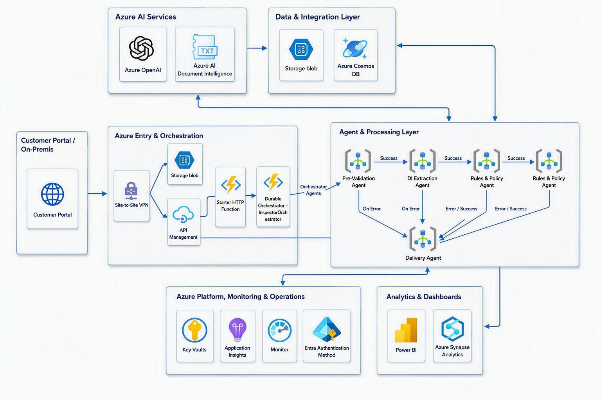
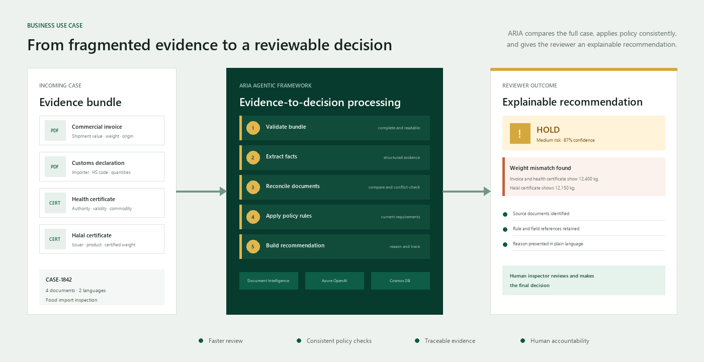
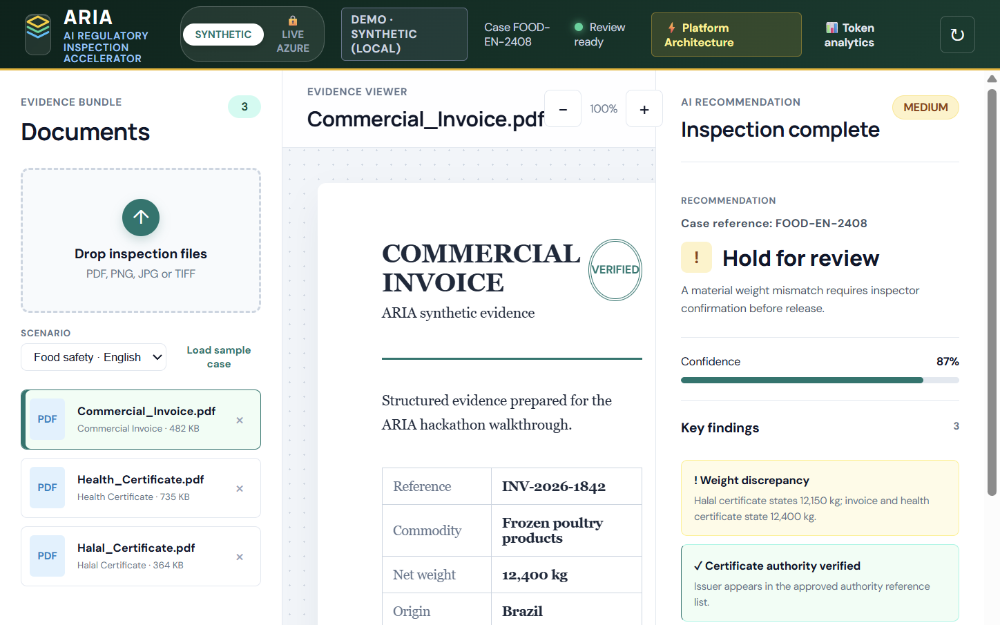
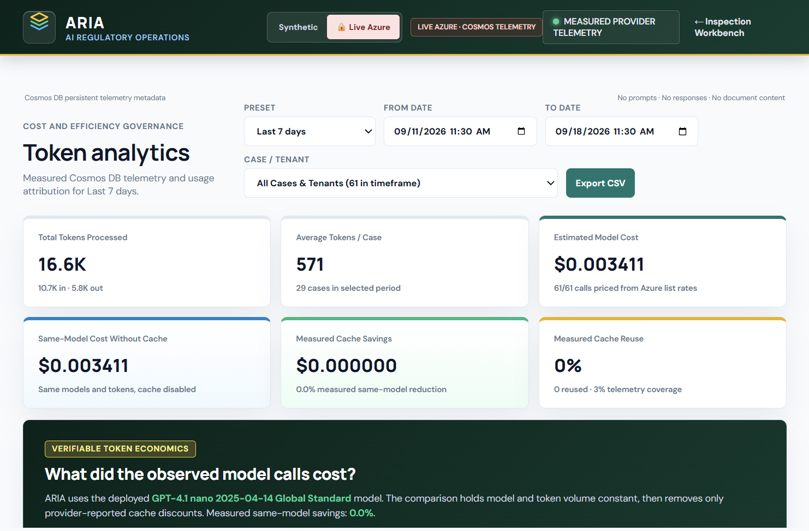
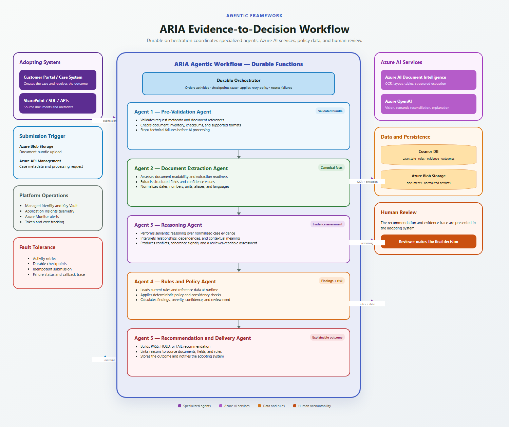
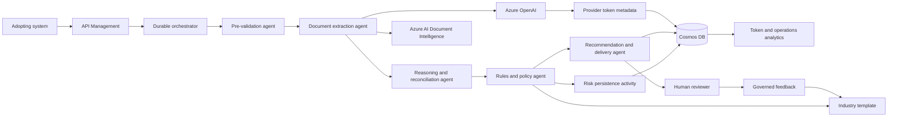

<div align="center">

# ARIA - AI Regulatory Inspection Accelerator

<strong>Evidence to decision for regulated multi-document review.</strong><br>
Extract facts. Reconcile evidence. Apply policy. Explain the recommendation.

<br>

[**SOLUTION OVERVIEW**](#solution-overview) &nbsp;|&nbsp; [**TRY THE DEMO**](#try-the-demo) &nbsp;|&nbsp; [**BUSINESS USE CASES**](#business-use-cases) &nbsp;|&nbsp; [**WINNING FORMULA**](#winning-formula) &nbsp;|&nbsp; [**ARCHITECTURE**](#agentic-framework) &nbsp;|&nbsp; [**QUICK DEPLOY**](#quick-deploy) &nbsp;|&nbsp; [**TEMPLATES**](#reference-templates)

</div>

ARIA turns a related evidence bundle into a reviewable recommendation. It extracts facts, reconciles them across documents, applies deterministic policy rules, scores risk, and preserves the evidence and timing trace for a human reviewer. Each review also produces governed signals that teams can use to improve reusable templates, rules, prompts, and delivery patterns.

The reference implementation supports English and Arabic documents, including mixed right-to-left content. Additional languages can be added through reviewed evaluation data, field aliases, normalization, and domain templates.

## Solution overview

ARIA treats the case, not the individual document, as the unit of review:

1. **Validate** the submission and mandatory evidence.
2. **Extract** structured facts from each document.
3. **Reconcile** shared fields across the bundle.
4. **Evaluate** deterministic policy rules and risk.
5. **Deliver** an explainable recommendation for human review.

The first reference implementation covers food import inspection with invoices, declarations, health certificates, certificates of origin, and Halal certificates. The platform packages these capabilities separately from domain configuration, allowing a proven implementation to become a reusable starting point rather than a one-off delivery.

Reviewer approvals, overrides, rework, processing time, quality outcomes, and token telemetry form a governed feedback loop. Teams can use those signals to refine reusable assets and compare successive runs, making improvements in quality and efficiency visible instead of resetting learning for each deployment.

The supplied solution architecture shows the broader Azure entry, AI, persistence, processing, monitoring, and analytics layers. Deployment-specific services can be selected or substituted by each adopter.



## Try the demo

https://github.com/user-attachments/assets/0335c898-4e95-4909-be80-633d0e3eedba

* [Open the live Inspection Workbench](https://stariainfra.z13.web.core.windows.net/index.html)
* [Open Token Analytics](https://stariainfra.z13.web.core.windows.net/tokens.html)
* [Read the demo walkthrough](docs/HackathonDemo.md)

<video controls preload="metadata" width="100%">
  <source src="media/ARIA-Demo-with-speech.mp4" type="video/mp4">
  Your browser does not support embedded video. [Watch or download the ARIA demo](media/ARIA-Demo-with-speech.mp4).
</video>

The demo runs a live three-document inspection, shows the recommendation and timed decision trace, then moves to token and cost analytics.

### Public demo steps

1. Open the [Inspection Workbench](https://stariainfra.z13.web.core.windows.net/index.html).
2. Keep **Synthetic** mode selected. This path runs in the browser and does not use an Azure subscription.
3. Select **Load sample case**, choose the Food Safety English or Arabic scenario, and select **Run inspection**.
4. Review the recommendation, findings, cross-document checks, confidence, and decision trace.
5. Open [Token Analytics](https://stariainfra.z13.web.core.windows.net/tokens.html) to review the operations view.

The hosted demo is provided for evaluation and uses shared demo assets. Do not enable Live Azure mode unless you are an authorized maintainer of the deployment.

### Local browser-only preview

No Azure subscription or Python package installation is required for the synthetic workbench:

```powershell
python -m http.server 4173 --directory reference-implementations/food-inspection/ui
```

Open <http://localhost:4173/index.html>, keep **Synthetic** mode selected, load a sample case, and run the inspection. This local path does not call Azure AI services.

## Business use cases

ARIA is designed for decisions that depend on several documents agreeing:

| Domain | Evidence bundle | Reviewer outcome |
|--------|-----------------|------------------|
| Food import inspection | Invoice, declaration, health and Halal certificates | Pass, hold, or fail |
| Customs clearance | Bill of lading, declaration, invoice, origin certificate | Clear, hold, or detain |
| KYC and AML | Identity, ownership, address, and transaction records | Approve, review, or reject |
| Healthcare authorization | Request form, clinical notes, and policy evidence | Authorize, review, or deny |
| Licensing and certification | Application, credentials, and prior certificates | Approve, provision, or deny |



The Inspection Workbench brings source evidence, cross-document findings, policy results, risk, and the human-controlled recommendation into one review surface.



The companion operations view makes token use, provider cache reuse, model cost, and telemetry coverage inspectable by case and processing stage.



### Token and cache economics

The Token Analytics dashboard separates measured provider telemetry from modeled comparisons. For each Azure OpenAI call, ARIA records input, output, total, and provider-reported cached-input tokens, together with model, activity, latency, case, and timestamp metadata. Prompts, model responses, and document content are not stored in the telemetry container.

Azure OpenAI manages prompt caching. ARIA improves cache eligibility by placing stable instructions and schema context before variable evidence, then reads `prompt_tokens_details.cached_tokens` from the provider response. Cosmos DB persists that measurement so usage can be compared over time; it does not perform the model cache lookup.

The dashboard prices the observed workload at published model rates and compares it with the same model and token volume with caching disabled. Only records marked as provider-measured receive a cached-input discount. Historical estimates remain visible for audit context but are excluded from measured cache savings.

See [Token Efficiency](docs/architecture/TechnicalArchitecture.md#6-token-efficiency) for the platform strategy and [ARIA Token Analytics](https://stariainfra.z13.web.core.windows.net/tokens.html) for the live operations view.

## Winning formula

| Capability | ARIA outcome |
|------------|--------------|
| Evidence bundle | One case view across invoices, declarations, certificates, and supporting records |
| Document understanding | Azure AI Document Intelligence plus Azure OpenAI structured extraction |
| Cross-document integrity | Canonical fields, aliases, unit normalization, and conflict detection |
| Policy boundary | Deterministic rules and risk scoring remain outside the model |
| Explainability | Findings link values, documents, rules, actions, and stage timings |
| Human control | The system recommends; the reviewer decides and can override with a reason |
| Operational governance | Cosmos DB telemetry, token attribution, cost views, and auditable case history |
| Compounding reuse | Reviewer feedback and delivery telemetry guide improvements to shared templates, rules, prompts, and evaluation assets |

## Implementation

The tested reference implementation combines a domain-neutral platform, configurable industry templates, and isolated connectors:

* Python Azure Functions, Durable Functions, and Azure API Management
* Azure AI Document Intelligence and Azure OpenAI structured extraction
* Deterministic reconciliation, policy, risk, delivery, and audit components
* Industry configuration under `templates/` and integration contracts under `connectors/`

The live path extracts documents concurrently, reports per-document duration, and keeps telemetry persistence off the response critical path. Automated tests cover orchestration, extraction, reconciliation, policy, risk, telemetry, templates, delivery, and audit behavior.

Technical setup, security, deployment topology, and local development instructions are maintained in the [Technical Architecture](docs/architecture/TechnicalArchitecture.md), [Deployment Guide](docs/DeploymentGuide.md), and [Local Development Setup](docs/LocalDevelopmentSetup.md).

## Agentic framework

Azure Durable Functions coordinates five specialized processing agents and a separate risk-persistence activity. Each agent has a narrow responsibility, passes an inspectable contract to the next stage, and routes failures to delivery so the adopting system receives a traceable outcome.





The detailed architecture, security model, data flow, and Azure topology are in the [Technical Architecture](docs/architecture/TechnicalArchitecture.md).

## Reference templates

An industry template separates reusable platform code from domain policy. The food-safety reference includes:

* `evidence_types.json` - mandatory and optional document types
* `submission_schema.json` - case and document submission contract
* `rules.json` - deterministic policy checks
* `rule_risk_scores.json` and `risk_scoring_thresholds.json` - severity and risk bands
* `normalization.json` - units, aliases, and canonical values
* `decision_vocabulary.json` - reviewer-facing outcomes
* `reference_data.json` and `knowledge_pack.json` - approved authorities and domain context

Use the same structure for customs, KYC, healthcare authorization, licensing, insurance, or another regulated workflow. Template schemas are under `templates/_schema/`.

Example mandatory evidence configuration:

```json
{
  "evidenceTypes": [
    { "id": "commercial_invoice", "required": true },
    { "id": "health_certificate", "required": true },
    { "id": "certificate_of_origin", "required": true },
    { "id": "halal_certificate", "required": false }
  ]
}
```

## Quick deploy

The public synthetic demo requires no Azure subscription. For an owned deployment, use the [Deployment Guide](docs/DeploymentGuide.md), which contains the Azure prerequisites, identity requirements, service topology, and configuration steps.

## Future scope

* A grounded case chatbot for reviewer questions, evidence citations, and reasoning exploration
* Reviewed multi-language packs with language-specific evaluation and abstention tests
* Longitudinal quality and efficiency curves across successive governed deployments
* Broader industry templates and connector implementations

## Repository map

```text
src/platform/                 Domain-neutral processing components
templates/                    Industry evidence, field, rule, and decision configuration
connectors/                   Integration contracts and adapters
reference-implementations/    Isolated adopter examples and workbench UI
media/                        Demo assets
infra/infra/                  Azure Terraform infrastructure
docs/                         Architecture, deployment, evaluation, and adoption material
tests/                        Automated platform and policy tests
```

## Documentation

* [Technical Architecture](docs/architecture/TechnicalArchitecture.md)
* [Arabic-English Evaluation Standard](docs/ArabicEnglishEvaluation.md)
* [Customize an Industry Template](docs/CustomizeIndustryTemplate.md)
* [Deployment Guide](docs/DeploymentGuide.md)
* [Demo Walkthrough](docs/HackathonDemo.md)
* [Local Development Setup](docs/LocalDevelopmentSetup.md)
* [Adoption Guide](docs/AdoptionGuide.md)
* [Responsible AI Transparency FAQ](TRANSPARENCY_FAQ.md)

ARIA produces recommendations, not autonomous high-stakes decisions. Each adopter must complete representative evaluation, security, privacy, responsible AI, and regulatory review before production use.

## License

See [LICENSE](LICENSE) for terms.
