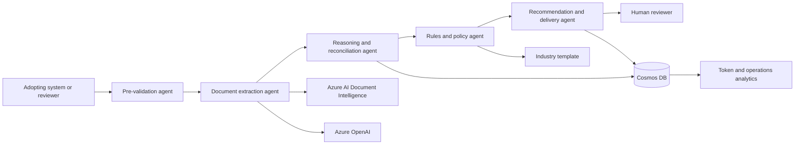

ARIA turns a related evidence bundle into a reviewable recommendation. It extracts facts, reconciles them across documents, applies deterministic policy rules, scores risk, and preserves the evidence and timing trace for a human reviewer.

The reference implementation is validated with food import inspection evidence and supports English and Arabic documents, including mixed right-to-left content. Additional languages can be added through reviewed evaluation data, field aliases, normalization, and domain templates.

## Try the demo

* [Open the live Inspection Workbench](https://stariainfra.z13.web.core.windows.net/index.html)
* [Open Token Analytics](https://stariainfra.z13.web.core.windows.net/tokens.html)
* [Read the demo walkthrough](docs/HackathonDemo.md)

<video controls preload="metadata" width="100%">
  <source src="media/ARIA-Demo-with-speech.mp4" type="video/mp4">
  Your browser does not support embedded video. [Watch or download the ARIA demo](media/ARIA-Demo-with-speech.mp4).
</video>

The demo runs a live three-document inspection, shows the recommendation and timed decision trace, then moves to token and cost analytics.

### Public demo steps

1. Open the [Inspection Workbench](https://stariainfra.z13.web.core.windows.net/index.html).
2. Keep **Synthetic** mode selected. This path runs in the browser and does not use an Azure subscription.
3. Select **Load sample case**, choose the Food Safety English or Arabic scenario, and select **Run inspection**.
4. Review the recommendation, findings, cross-document checks, confidence, and decision trace.
5. Open [Token Analytics](https://stariainfra.z13.web.core.windows.net/tokens.html) to review the operations view.

The hosted demo is provided for evaluation and uses shared demo assets. Do not enable Live Azure mode unless you are an authorized maintainer of the deployment.

### Local browser-only preview

No Azure subscription or Python package installation is required for the synthetic workbench:

```powershell
python -m http.server 4173 --directory reference-implementations/food-inspection/ui
```

Open <http://localhost:4173/index.html>, keep **Synthetic** mode selected, load a sample case, and run the inspection. This local path does not call Azure AI services.

## Winning formula

| Capability | ARIA outcome |
|---|---|
| Evidence bundle | One case view across invoices, declarations, certificates, and supporting records |
| Document understanding | Azure AI Document Intelligence plus Azure OpenAI structured extraction |
| Cross-document integrity | Canonical fields, aliases, unit normalization, and conflict detection |
| Policy boundary | Deterministic rules and risk scoring remain outside the model |
| Explainability | Findings link values, documents, rules, actions, and stage timings |
| Human control | The system recommends; the reviewer decides and can override with a reason |
| Operational governance | Cosmos DB telemetry, token attribution, cost views, and auditable case history |

## Solution implementation

The tested reference implementation combines:

* Python Azure Functions for authenticated live inspection and delivery
* Azure AI Document Intelligence for OCR and layout extraction
* Azure OpenAI `aria-text-mini` for structured field extraction, with a vision deployment available for fallback
* A domain-neutral platform under `src/platform/`
* Food-safety configuration under `templates/food-safety/`
* Azure Blob Storage for evidence and the hosted workbench
* Cosmos DB for telemetry and case records
* Azure API Management for the public API facade
* Azure Terraform infrastructure under `infra/infra/`

The live path extracts documents concurrently, reports per-document duration, and keeps telemetry persistence off the response critical path. The complete automated test suite currently passes 426 tests.

## Agentic framework

Azure Durable Functions coordinates the processing stages. Each agent has a narrow responsibility and produces an inspectable output.



The detailed architecture, security model, data flow, and Azure topology are in the [Technical Architecture](docs/architecture/TechnicalArchitecture.md).

## Reference templates

An industry template separates reusable platform code from domain policy. The food-safety reference includes:

* `evidence_types.json` - mandatory and optional document types
* `submission_schema.json` - case and document submission contract
* `rules.json` - deterministic policy checks
* `rule_risk_scores.json` and `risk_scoring_thresholds.json` - severity and risk bands
* `normalization.json` - units, aliases, and canonical values
* `decision_vocabulary.json` - reviewer-facing outcomes
* `reference_data.json` and `knowledge_pack.json` - approved authorities and domain context

Use the same structure for customs, KYC, healthcare authorization, licensing, insurance, or another regulated workflow. Template schemas are under `templates/_schema/`.

Example mandatory evidence configuration:

```json
{
  "evidenceTypes": [
    { "id": "commercial_invoice", "required": true },
    { "id": "health_certificate", "required": true },
    { "id": "certificate_of_origin", "required": true },
    { "id": "halal_certificate", "required": false }
  ]
}
```

## Prerequisites

* Python 3.10 or later
* Azure subscription for live deployment
* Azure Functions, Storage, Cosmos DB, Document Intelligence, Azure OpenAI, Key Vault, and API Management for the full reference topology
* Managed identity and role assignments for service-to-service access
* Representative English and Arabic evidence, reviewer-approved expected outcomes, and an evaluation corpus

## Future scope

* A grounded case chatbot for reviewer questions, evidence citations, and reasoning exploration
* Reviewed multi-language packs with language-specific evaluation and abstention tests
* Real-time telemetry streaming from Durable Functions
* Broader industry templates and connector implementations

## Repository map

```text
src/platform/                 Domain-neutral processing components
templates/                    Industry evidence, field, rule, and decision configuration
connectors/                   Integration contracts and adapters
reference-implementations/    Isolated adopter examples and workbench UI
media/                        Demo assets
infra/infra/                  Azure Terraform infrastructure
docs/                         Architecture, deployment, evaluation, and adoption material
tests/                        Automated platform and policy tests
```

## Documentation

* [Technical Architecture](docs/architecture/TechnicalArchitecture.md)
* [Arabic-English Evaluation Standard](docs/ArabicEnglishEvaluation.md)
* [Customize an Industry Template](docs/CustomizeIndustryTemplate.md)
* [Deployment Guide](docs/DeploymentGuide.md)
* [Demo Walkthrough](docs/HackathonDemo.md)
* [Local Development Setup](docs/LocalDevelopmentSetup.md)
* [Adoption Guide](docs/AdoptionGuide.md)
* [Responsible AI Transparency FAQ](TRANSPARENCY_FAQ.md)

ARIA produces recommendations, not autonomous high-stakes decisions. Each adopter must complete representative evaluation, security, privacy, responsible AI, and regulatory review before production use.

## License

See [LICENSE](LICENSE) for terms.
