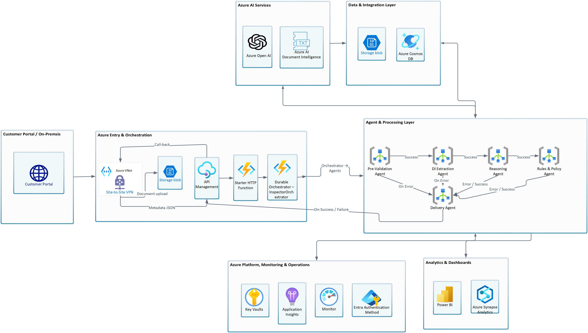

# ARIA - AI Regulatory Inspection Accelerator

Process multi-document regulatory and compliance submissions by extracting structured data from every document, reconciling facts across the entire bundle, evaluating configurable policy rules, and producing an explainable, auditable decision. Upload a document bundle - invoices, certificates, declarations, applications, claims - and the solution processes each document through a token-efficient extraction pipeline, then orchestrates cross-document validation, risk scoring, and decision delivery through a multi-agent workflow.

The core evidence-to-decision engine supports any multi-document, policy-driven review workflow with runtime-configurable rules and confidence scoring. These capabilities apply to numerous use cases including: food safety inspection, customs clearance, KYC/AML validation, healthcare compliance, environmental compliance, licensing and certification, and financial compliance review.

<div align="center">

[**SOLUTION OVERVIEW**](#solution-overview) | [**FEATURES**](#features) | [**GETTING STARTED**](#getting-started) | [**BUSINESS SCENARIO**](#business-scenario) | [**SUPPORTING DOCUMENTATION**](#supporting-documentation)

</div>

> Note: With any AI solution you build using this accelerator, you are responsible for assessing associated risks and complying with applicable laws and standards. See [Responsible AI Transparency FAQ](TRANSPARENCY_FAQ.md).

---

## Solution overview

This accelerator leverages Azure Document Intelligence, Azure OpenAI Service, Azure Durable Functions, Azure Cosmos DB, and Azure AI Search to process multi-document evidence bundles through a five-stage pipeline:

- **Evidence Intake** - Documents are staged in Blob Storage by the source system's connector (see Connector Framework below - staging mechanism is connector-specific, for example a direct upload integration or a SAS-scoped URL), then a REST API call with immediate acknowledgement (HTTP 202) references them by ID to start processing. Validates bundle integrity - checksums, MIME types, document count, and file sizes - via the Storage SDK before any AI processing begins.
- **Document Intelligence** - Each document is assessed for quality, processed through Azure Document Intelligence, and extracted into structured fields using auto-generated prompts derived from a JSON field schema. Adding a new document type requires only a configuration entry, not a code change.
- **Cross-Document Validation** - The platform reasons across all documents in the bundle simultaneously: resolving semantic field-name variations, detecting cross-document inconsistencies, and assembling a unified evidence map.
- **Policy & Risk Evaluation** - Compliance rules are loaded from Cosmos DB at runtime - rule changes take effect immediately without redeployment. Findings and extraction confidence determine a risk level that decides whether a case is auto-resolved or escalated for human review.
- **Recommendation** - A structured, explainable decision is delivered with a complete field-level evidence chain. Cases requiring judgment are flagged for human review.

Processing, extraction, validation, and decision steps are tracked with status and scored for confidence to automate routine cases and identify as-needed human review.

### Solution architecture

The platform is structured in three tiers so it can be deployed across regulated industries without rework: a domain-neutral **Core Platform** (the engines described above) implements extraction, validation, and decisioning logic once; **Industry Templates** (configuration packages - JSON and Markdown only, no executable code) adapt the platform to a specific regulated domain in days, not months; and **Reference Implementations** are complete, isolated deployments built on the Core Platform and a template. See [Technical Architecture](docs/architecture/TechnicalArchitecture.md) for the full architecture, component design, Azure reference architecture, and governing key decisions.



| Component | Role |
|---|---|
| Evidence Intake Engine | Bundle validation, integrity checks, format normalization |
| Document Intelligence Engine | Structured + AI-assisted field extraction |
| Cross-Document Validation Engine | Semantic reconciliation and conflict detection |
| Policy Evaluation Engine | Deterministic, runtime-configurable rule evaluation |
| Risk Assessment Engine | Risk-based escalation logic |
| Recommendation Engine | Verdict synthesis, evidence chain, secure decision delivery, with human-in-the-loop escalation for low-confidence or high-risk cases |
| Human Review Framework (Chat Agent) | Conversational, evidence-grounded interface for the human reviewer *(Phase 2)* |
| Audit and Explainability Framework | Immutable event logging and plain-language decision rationale |
| Connector Framework | Pluggable inbound/outbound integration contract |
| Template Framework | Industry configuration packaging and lifecycle management |

### Agentic architecture

The pipeline is orchestrated as a coordinated set of agents and processing stages, each responsible for one part of the reasoning rather than a single monolithic prompt. Five stages run sequentially per case; three additional components run asynchronously or in the background:

```
Intake Stage → Extraction Agent → Validation Agent → Policy Stage → Recommendation Agent
           ↘ Chat Agent (Phase 2)    ↘ Audit Assistant Agent    ↘ Knowledge Pack Stage
```

**Phase 1 ships Recommendation** - Intake Stage through Recommendation Agent above, with human-in-the-loop review built in: low-confidence and high-risk cases are always routed to a human reviewer. The Chat Agent adds a conversational interface to that same review step and ships in Phase 2 (see Roadmap).

A background Knowledge Pack Stage is designed to keep each industry template's compressed policy context current whenever rules change, without requiring a redeployment - this component is not yet built (see [Roadmap](#roadmap)).

| Design principle | Detail |
|---|---|
| Token efficiency | Documents are normalized to clean Markdown and structured extraction runs first so the model only fills genuine gaps - both proven in the PAFN reference deployment; large documents are designed to be chunked to relevant sections and policy context compressed into a compact Knowledge Pack instead of a full rule set per prompt - both planned, not yet built |
| Deterministic policy evaluation | Rule evaluation is config-driven and deterministic - no LLM call is required to apply a compliance rule |
| Human-in-the-loop | Low-confidence and high-risk cases are always routed to a human reviewer; every override requires a documented rationale. The Chat Agent adds a conversational interface to that review step *(Phase 2)* |
| Extensibility | Add a new document type, rule, or industry template without modifying platform code |

---

## Features

### Key features

- **Multi-document bundle intake** - Upload a full evidence bundle in a single submission; the platform validates integrity and stages every document for processing as one unit.
- **Configuration-driven extraction** - New document types are added via JSON configuration; the extraction prompt is auto-generated from the field schema.
- **Cross-document semantic reconciliation** - Resolves field-name variations across documents and languages, and detects contradictions across the full bundle.
- **Runtime-configurable policy engine** - Compliance rules are evaluated deterministically against eight rule categories, loaded from Cosmos DB and effective immediately on change.
- **Risk-based escalation** - Findings and extraction confidence determine a High/Medium/Low risk level that routes cases to human review; a configurable weighted risk matrix with historical case-pattern calibration is a planned enhancement, not yet built in the PAFN reference deployment.
- **Explainable decisions with full evidence chain** - Every decision traces back to the source document, field, and rule that produced it.
- **Human-in-the-loop by default (Phase 1)** - Low-confidence or high-risk cases are automatically queued for human review before any decision is finalized; no fully autonomous high-stakes decision is made.
- **Chat Agent for human review** *(Phase 2)* - A conversational agent lets reviewers ask questions about case evidence, grounded in the submitted case, with mandatory override rationale capture.
- **Immutable audit trail** - Every model call, rule evaluation, and human action is logged for point-in-time decision reconstruction.
- **Pluggable connector framework** - Inbound submission sources and outbound decision delivery integrate via a documented connector contract.

---

## Getting Started

1. Clone the repository and review [Technical Architecture](docs/architecture/TechnicalArchitecture.md) for full platform context.
2. Provision Azure prerequisites (Azure OpenAI, Azure Document Intelligence, Cosmos DB, Azure AI Search, Storage, Key Vault) using the Terraform modules in `infra/terraform/` for a single-tenant deployment - see the [Deployment Guide](docs/DeploymentGuide.md).
3. Configure environment variables for AI service endpoints and Managed Identity, following the zero-secrets configuration pattern (no connection strings or API keys in code).
4. Install and activate an industry template (starting with the Food Safety template) - see [Customize: Add a New Industry Template](docs/CustomizeIndustryTemplate.md) if you want to add your own.
5. Submit a sample multi-document case bundle to the intake endpoint and observe the pipeline through to decision delivery.

### Prerequisites and costs

Deployment requires an Azure subscription with permissions to create resource groups, resources, and role assignments at the resource group level. Pricing varies by region and usage; most resources use consumption-based pricing tiers. Use the [Azure pricing calculator](https://azure.microsoft.com/en-us/pricing/calculator) to estimate cost for your subscription, and remember to tear down unused resources (`terraform destroy`) to avoid ongoing charges.

| Azure Resource | Role | Pricing |
|---|---|---|
| Azure OpenAI Service | Field extraction, cross-document reasoning, decision explanation, and the Chat Agent | [Pricing](https://azure.microsoft.com/pricing/details/cognitive-services/openai-service/) |
| Azure AI Document Intelligence | Structured OCR and prebuilt-model extraction | [Pricing](https://azure.microsoft.com/pricing/details/ai-document-intelligence/) |
| Azure Functions (Durable Functions) | Pipeline orchestration across the five processing stages | [Pricing](https://azure.microsoft.com/pricing/details/functions/) |
| Azure Cosmos DB | Case records, runtime-configurable rules, verdicts, and audit trail | [Pricing](https://azure.microsoft.com/pricing/details/cosmos-db/) |
| Azure AI Search | Case history indexing for risk calibration | [Pricing](https://azure.microsoft.com/pricing/details/search/) |
| Azure API Management | Submission gateway and schema validation | [Pricing](https://azure.microsoft.com/pricing/details/api-management/) |
| Azure Key Vault | Managed Identity-based secret storage (HMAC signing keys) | [Pricing](https://azure.microsoft.com/pricing/details/key-vault/) |
| Azure Blob Storage | Raw and normalized document storage | [Pricing](https://azure.microsoft.com/pricing/details/storage/blobs/) |

### Repository Structure

```
src/platform/                          Core Platform - domain-neutral engines (Tier 1)
  intake/                              Evidence Intake Engine
  document_intelligence/               Document Intelligence Engine
  reconciliation/                      Cross-document semantic reconciliation
  cross_document/                      Cross-Document Validation Engine
  policy/                              Policy Evaluation Engine
  risk/                                Risk Assessment Engine
  decision/                            Recommendation Engine
  human_review/                        Human Review Framework - Chat Agent (Phase 2 - see Roadmap)
  explainability/                      Explainability Framework
  audit/                               Audit and Lineage Framework
  reporting/                           Reporting Framework (observability, token cost, cache hit rate)
  orchestration/                       Durable Functions orchestrator
  knowledge/                           Knowledge Pack and retrieval services
src/api/                               Submission gateway (FastAPI)
src/models/                            Shared data models
src/shared/                            Azure service client wrappers (incl. AI client)
src/evaluation/                        Accuracy evaluation framework
templates/_schema/                     Template validation schema
templates/{industry-name}/             Industry Templates (Tier 2) - JSON + Markdown only
connectors/sdk/                        BaseConnector abstract contract
connectors/{name}/                     Built-in and named connectors
reference-implementations/{name}/      Reference Implementations (Tier 3) - customer-isolated
infra/terraform/                       Infrastructure as Code modules
```

---

## Configuration Overview

Industry behavior is defined entirely through a template's configuration artifacts - never through platform code changes:

- Document type and field definitions
- Policy rule seed data
- Domain reference data (code lists, taxonomies)
- Submission schema for gateway validation
- Risk weight matrix and threshold bands
- Known field-name alias pairs
- Cross-document validation rules
- Decision outcome vocabulary
- PII field declarations
- Domain-specific review tools
- Dashboard and KPI configuration
- Ground truth evaluation data

Rule changes made in the underlying configuration store take effect immediately for new cases - no code deployment required.

---

## Business scenario

Teams that review multi-document regulatory and compliance submissions - customs clearance, KYC/AML checks, healthcare compliance, licensing, environmental compliance - face the same constraints regardless of industry:

- Cross-referencing every document by hand is slow, and consistency depends on individual reviewer experience.
- Policy rules change frequently, but updates typically require a code deployment before they take effect.
- Every decision must be defensible after the fact, but audit trails are often incomplete or scattered across systems.

ARIA addresses this with a configuration-driven pipeline that extracts, reconciles, evaluates, and delivers an explainable decision for any multi-document, policy-driven review - built once on the Core Platform, then adapted to a new regulated industry through a template rather than a new codebase.

### Reference case: food import inspection (PAFN)

The first production-validated deployment is a food import inspection workflow for a national food safety authority (PAFN). An inspector receives an incoming shipment declaration - an invoice, packing list, certificate of origin, health certificate, and (where applicable) a Halal certificate - that must be reviewed together before the shipment can be released.

Prior to automation, an inspector manually cross-referenced every document: confirming the invoice's net weight matched the packing list, verifying the certificate of origin was valid for the declared HS code, checking certificate expiry against the shipment date, and applying the ministry's current food safety rules - a process taking 20 to 35 minutes per case.

With ARIA, the inspector submits the full document bundle to the platform, which automatically:

1. **Extracts structured data from every document** - invoice values, certificate numbers, country of origin, expiry dates - using config-driven extraction, including Arabic and English bilingual documents.
2. **Reconciles the bundle** - resolving field-name variations across languages and detecting cross-document inconsistencies (for example, a net weight mismatch between the invoice and packing list, or an expired certificate).
3. **Evaluates ministry policy rules** loaded at runtime from Cosmos DB - mandatory certificate requirements, HS code restrictions, and cross-document consistency checks - producing a risk level from the findings and extraction confidence.
4. **Delivers a decision** - PASS, HOLD, or FAIL - with a complete, field-level evidence chain, escalating HOLD/FAIL cases to human review. The Chat Agent lets reviewers ask evidence questions conversationally.

The same Core Platform, unchanged, applies this pattern to customs clearance, KYC/AML validation, healthcare compliance, and other multi-document, policy-driven decision workflows - only the industry template changes.

### Use cases by industry

The objective is to reuse the same AI inspection engine across many government and private-sector entities without reinventing anything that already works - adopting a new industry means authoring a template (13 JSON/Markdown configuration files), never new platform code. The only legitimate platform-side additions are genuine efficiency gains, such as converting Office documents to Markdown before extraction to reduce token usage.

| Industry | Sector | Example adopting entity | Documents reviewed | Decision outcome | Template |
|---|---|---|---|---|---|
| Food safety inspection | Government | National food safety or customs ministry (PAFN reference deployment) | Invoice, packing list, certificate of origin, health certificate, Halal certificate | PASS · HOLD · FAIL | `food-safety` |
| Customs clearance | Government | Customs and border agencies | Commercial invoice, bill of lading, certificate of origin, customs declaration | CLEAR · HOLD · DETAIN | `customs-trade` |
| Environmental compliance | Government | Environmental protection agencies | Environmental impact assessments, permits, inspection reports | APPROVE · CONDITIONAL · DENY | `environmental` |
| Licensing and certification | Government or private issuing body | Licensing boards, professional certification bodies | Applications, supporting credentials, prior certifications | APPROVE · PROVISIONAL · DENY | `licensing-cert` |
| Healthcare compliance | Private (or government payer) | Hospitals, insurers, health plans | Claims, prior authorizations, medical records | AUTHORIZE · PEER REVIEW · DENY | `healthcare-compliance` |
| Financial compliance (KYC/AML) | Private | Banks, fintechs, financial institutions | Identity documents, beneficial ownership filings, transaction records | APPROVE · EDD · REJECT | `kyc-aml` |

Every row above uses the same Core Platform, the same connector model (third-party system submits over Blob SDK/API, ARIA processes, then calls back to the submitting system's own portal), and the same token-efficiency techniques - only the template's 13 configuration files differ. See [Template Framework](docs/architecture/TechnicalArchitecture.md#7-template-framework) for the full industry template mapping and [Customize: Add a New Industry Template](docs/CustomizeIndustryTemplate.md) to add your own.

### Business value

- **Faster decisions** - Cross-referencing that took 20-35 minutes per case in the PAFN reference deployment is completed in under two minutes, with a full audit trail retained for any subsequent regulatory challenge.
- **Lower cost to expand into new regulated domains** - A new industry is a template - 13 JSON/Markdown configuration files - not a new codebase or a new deployment of platform engineering effort.
- **Consistent, defensible outcomes** - Every decision traces back to the source document, field, and rule that produced it, reducing variance between reviewers and strengthening audit response.
- **Rules that keep pace with policy change** - Compliance rules take effect immediately from configuration changes, without a redeployment cycle.
- **Human accountability retained** - Low-confidence or high-risk cases are always escalated to a human reviewer; every override requires a documented rationale, and no high-stakes decision is made fully autonomously.

> **Implementation status:** This repository currently ships the reference architecture, ADRs, connector contract, and configuration schema described above. Core Platform engine code (`src/platform/`) is under active implementation, generalized from the validated PAFN reference deployment - see [Roadmap](#roadmap). Track progress or contribute via [Issues](https://github.com/microsoft/dstoolkit-document-inspection-agent/issues).

---

## Supporting documentation

### Security guidelines

This accelerator uses [Managed Identity](https://learn.microsoft.com/entra/identity/managed-identities-azure-resources/overview) for all service-to-service authentication - no connection strings or secrets are stored in application code. Secrets required for external integrations (such as HMAC callback signing keys) are stored in Azure Key Vault.

Additional security considerations for deployments built on this accelerator:

- Enable [Microsoft Defender for Cloud](https://learn.microsoft.com/azure/security-center/defender-for-cloud) to monitor and secure Azure resources
- Use Private Endpoints for all data and AI services (Cosmos DB, Blob Storage, Azure OpenAI, Document Intelligence, AI Search, Key Vault)
- Enable [GitHub secret scanning](https://docs.github.com/code-security/secret-scanning/about-secret-scanning) on repositories built from this template
- Implement authentication and authorization for any reviewer-facing application using Microsoft Entra ID

### Cross references

This accelerator addresses the decision layer above document extraction - cross-document validation, configurable policy reasoning, risk assessment, and auditable decision delivery. For single-document extraction, knowledge mining, and chat-over-documents scenarios, see related Microsoft Solution Accelerators:

| Accelerator | Focus |
|---|---|
| [Content Processing Solution Accelerator](https://github.com/microsoft/content-processing-solution-accelerator) | Extract data and apply schemas to unstructured, multi-modal documents |
| [Document Knowledge Mining Solution Accelerator](https://github.com/microsoft/Document-Knowledge-Mining-Solution-Accelerator) | Extract summaries, entities, and metadata from documents; search and chat over the results |

---

## Provide feedback

Have questions, find a bug, or want to request a feature? [Submit a new issue](https://github.com/microsoft/dstoolkit-document-inspection-agent/issues) on this repo and we'll connect.

## Responsible AI Transparency FAQ

ARIA is designed so that AI never makes a fully autonomous high-stakes decision. Cases with low confidence or elevated risk are automatically routed to human review before a final decision is recorded. The Chat Agent answers reviewer questions using only submitted case evidence, never general knowledge. Every override requires a documented rationale, and every model call, rule evaluation, and human action is captured in an immutable audit log to support point-in-time reconstruction of any historical decision.

Please refer to [Transparency FAQ](TRANSPARENCY_FAQ.md) for full responsible AI transparency details of this accelerator. Organizations deploying ARIA in a regulated context should complete their own responsible AI, data protection, and compliance review appropriate to their jurisdiction before production use.

## Disclaimers

This accelerator is a solution accelerator and reference implementation, provided to help you build your own AI-powered evidence-to-decision solution on Azure. It is not a finished or certified product. Any deployment based on this accelerator should include your own testing, evaluation, and security review appropriate to your regulatory context before production use.

With any AI solution built using this accelerator, you are responsible for assessing associated risks and complying with applicable laws, industry regulations, and organizational policies. This software is not designed, intended, or made available as a substitute for professional legal, medical, or financial advice, diagnosis, treatment, or judgment.

To the extent this accelerator includes components derived from Microsoft products or services, use of those Microsoft Products and Services remains subject to their applicable Product Terms.

---

## Roadmap

| Stage | Focus |
|---|---|
| Current (Phase 1) | Core Platform Recommendation Engine (`src/platform/`) - Evidence Intake through Recommendation, with human-in-the-loop escalation built in - in progress, generalized from the validated Food Safety reference implementation |
| Phase 2 | Chat Agent - built in the PAFN reference deployment, generalizing into the Core Platform - in progress |
| Next | Additional industry templates (customs, healthcare, licensing, environmental, financial compliance, KYC/AML) validated independently |
| Future | Multi-tenant SaaS, Government Cloud, and sovereign/air-gapped deployment topologies; Azure Marketplace packaging |

---

## Contributing

This project welcomes contributions and suggestions. External contribution guidelines will expand as the project moves toward broader accelerator release. Contributors should follow the repository's pull request and code review conventions, with particular attention to keeping Core Platform code (`src/platform/`) free of industry- or customer-specific content. See [CONTRIBUTING.md](CONTRIBUTING.md) for details.

---

## License

See [LICENSE](LICENSE) for terms.