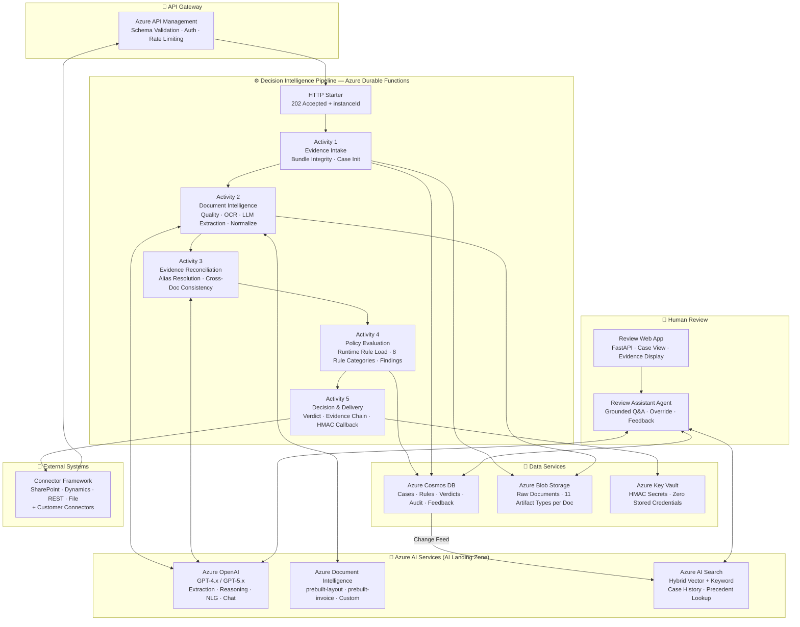

# ARIA — AI Regulatory Inspection Accelerator

**AI Evidence-to-Decision Platform**  |  Microsoft Azure Solution Accelerator

[](LICENSE)
[](https://azure.microsoft.com)
[](https://python.org)
[](https://learn.microsoft.com/azure/azure-functions/durable/)

ARIA is a configurable AI platform that converts fragmented multi-document evidence into explainable, auditable decisions through cross-document validation, runtime-configurable policy reasoning, risk assessment, and human-in-the-loop review. It helps teams evaluate evidence bundles, detect cross-document inconsistencies, apply domain rules, generate explainable recommendations, and preserve complete decision lineage — for any regulated or compliance-intensive workflow.

ARIA is not a document extraction or knowledge mining tool. It is a **Decision Intelligence Platform** — the layer between raw documentary evidence and a defensible, auditable verdict. Document extraction is one step. The differentiated value is what happens after: cross-evidence reconciliation, configurable policy evaluation, risk scoring, traceable decision delivery, and grounded human review.

ARIA ships with production-validated templates for regulatory inspection, customs clearance, KYC/AML onboarding, insurance claims adjudication, healthcare prior authorization, environmental permitting, licensing, and vendor qualification. New decision workflows onboard through configuration alone — no platform code changes required.

> **Reference implementations included:** Food Safety Inspection (PAFN, Kuwait — production-deployed), with additional templates for Customs Clearance, KYC/AML Onboarding, Insurance Claims Adjudication, and Healthcare Prior Authorization.

---

<div align="center">

[**SOLUTION OVERVIEW**](#solution-overview) | [**QUICK DEPLOY**](#quick-deploy) | [**BUSINESS SCENARIO**](#business-scenario) | [**SUPPORTING DOCUMENTATION**](#supporting-documentation)

</div>

---


## Solution overview

This accelerator leverages Azure Document Intelligence, Azure OpenAI Service, Azure Durable Functions, Azure Cosmos DB, and Azure AI Search to process multi-document evidence bundles through a five-stage AI pipeline:

- **Evidence Intake** — Receive multi-document submissions via REST API with immediate acknowledgement (HTTP 202). Validates bundle integrity: SHA-256 checksums, MIME types, document count, and file sizes — before any AI processing begins.
- **Document Intelligence** — Each document is assessed for quality, processed through Azure Document Intelligence OCR, and extracted into structured fields using auto-generated LLM prompts derived from a JSON field schema. Adding a new document type requires only a configuration entry — no code change.
- **Evidence Reconciliation** — The platform reasons across all documents simultaneously: resolving semantic field name variations (LLM-powered alias resolution), detecting cross-document inconsistencies, and assembling a unified canonical evidence map ready for policy evaluation.
- **Policy Evaluation** — Compliance rules are loaded from Cosmos DB at runtime — rule changes take effect immediately without redeployment. Domain experts own and manage the rule set without engineering involvement.
- **Decision Delivery** — A structured, explainable decision (Approve/Review Required/Decline, or domain-configured labels) is delivered with a complete field-level evidence chain via HMAC-signed async callback.

Processing, cross-document validation, policy evaluation, and decision steps are tracked with status and scored for confidence to support human-in-the-loop review where needed.

### Solution architecture

|  |
|:---:|
| *ARIA Evidence-to-Decision Platform — Five-Stage Pipeline* |

<details>
<summary>Click to view detailed architecture diagram</summary>



</details>

### Key design principles

> **Connector boundary note:** Platform connectors (SharePoint, Dynamics, REST, File) are reusable across all templates and deployments. Customer-specific connectors — such as the Raqeb connector used in the PAFN Food Safety reference implementation — live under `reference-implementations/{name}/connectors/` and are not part of the core platform connector framework.

| Principle | What it means |
|---|---|
| **Configuration over code** | New document types, rules, and industries require only configuration — no code deployment |
| **Evidence lineage by default** | Every decision is traceable from source document → extracted field → policy rule → verdict |
| **Rules externalized from code** | All compliance rules live in Cosmos DB; domain experts modify them without engineering |
| **Human accountability preserved** | Override workflow with mandatory rationale capture is a first-class capability |
| **Zero-trust by architecture** | Managed Identity throughout; private endpoints; no stored credentials; PII dual-tier write |

---

## Features

### Key features

<details open>
<summary>Click to learn more about the key features this solution enables</summary>

- **Cross-document evidence reconciliation** — The platform reasons across all submitted documents simultaneously, resolving semantic field name variations across languages and vocabularies, and detecting logical inconsistencies between documents that single-document extraction tools cannot identify.

- **Runtime-configurable policy rules** — Compliance rules are stored in Cosmos DB and loaded at evaluation time. Domain experts can add, modify, or retire rules without any code deployment or service restart. A rule changed at 11 PM is effective for the midnight batch.

- **Configurable document type extraction** — Document types and their field schemas are defined in a JSON configuration file. Extraction prompts are auto-generated from the schema. Adding a new document type requires a JSON entry — no code change.

- **Explainable, field-level decision evidence chain** — Every decision finding is linked to the specific document, page, extracted field value, and rule that produced it. Decisions can be reconstructed, field by field, years after they were made, using pinned rule ETags.

- **Human review with grounded AI** — The Review Assistant Agent answers reviewer questions by citing the actual extracted evidence from the submitted documents — not general AI knowledge. Override workflow captures reviewer rationale for the audit trail.

- **Industry template framework** — The platform ships with an Inspection Template (food safety reference implementation) and supports any decision workflow through a configuration package. New industries onboard without changing platform code.

- **PII privacy by design** — A dual-tier write pattern separates full evidence (including raw PII, stored in a secured container) from display findings (PII-redacted, available to reviewers). No PII appears in API responses or reviewer interfaces.

- **Async 202 + audited delivery** — Submissions are acknowledged immediately. Decisions are delivered via HMAC-signed HTTP callback with retry logic and a complete delivery audit log. Every delivery attempt is recorded.

- **Multi-language support** — BiDi/RTL Unicode processing for Arabic, Hebrew, and Farsi content. Date format normalization across 14+ international patterns. Eastern Arabic-Indic numeral normalization.

- **Production-hardened evaluation framework** — Measure field-level extraction accuracy against human-verified ground truth before go-live. Per-field accuracy reporting. Regression detection integrated into CI/CD.

</details>

---


## Quick deploy

### How to install or deploy

Follow the deployment guide to deploy this solution to your own Azure subscription.

> **Note:** This solution accelerator requires **Azure Developer CLI (azd) version 1.18.0 or higher**. [Download azd here](https://learn.microsoft.com/en-us/azure/developer/azure-developer-cli/install-azd).

> **Note:** This solution also requires **Terraform CLI version 1.5.0 or higher** for infrastructure deployment. [Install Terraform](https://developer.hashicorp.com/terraform/install).

[Click here to launch the deployment guide](./docs/DeploymentGuide.md)

| [](https://codespaces.new/microsoft/dstoolkit-document-inspection-agent) | [](https://vscode.dev/redirect?url=vscode://ms-vscode-remote.remote-containers/cloneInVolume?url=https://github.com/microsoft/dstoolkit-document-inspection-agent) |
|---|---|

> ⚠️ **Important: Check Azure OpenAI Quota Availability**  
> Ensure sufficient quota is available before deployment. Follow the [quota check instructions guide](./docs/QuotaCheck.md).

> 🛠️ **Need Help?** See the [Troubleshooting Guide](./docs/TroubleshootingGuide.md) for common deployment issues.

---


## Business scenario

ARIA applies the same five-stage pipeline across any domain where multi-document submissions must produce consistent, auditable decisions. The decision workflow, the evidence bundle, and the policy rules change — the platform does not.

### Platform applicability across industries

| Decision workflow | Evidence bundle | Decision output | ARIA capabilities used |
|---|---|---|---|
| **Food Safety Inspection** | Invoice, Packing List, Certificate of Origin, Health Certificate, Halal Certificate, Lab Analysis | PASS / HOLD / FAIL | All 5 stages · RTL language normalization · HS code validation |
| **Customs Clearance** | Commercial Invoice, Bill of Lading, Customs Declaration, Import License | CLEAR / HOLD / FLAG | Cross-document value comparison · Sanctions code validation |
| **KYC / AML Onboarding** | Identity Document, Proof of Address, Source of Funds, Beneficial Ownership | APPROVE / EDD / REJECT | Cross-doc consistency · Sanctions screening · Risk scoring |
| **Insurance Claims Adjudication** | Claim Form, Medical Records, Physician Notes, Treatment Plan, Bills | APPROVE / PARTIAL / DENY | Medical code reconciliation · Coverage policy evaluation |
| **Healthcare Prior Authorization** | Authorization Request, Clinical Notes, Lab Results, Treatment Plan | AUTHORIZE / PEER REVIEW / DENY | Step therapy compliance · Medical necessity rules |
| **Environmental Permitting** | Permit Application, EIA, Monitoring Reports, Emissions Test Results | APPROVE / CONDITIONAL / DENY | Threshold validation · Cross-period consistency |
| **Licensing and Certification** | License Application, Credentials, CE Records, Background Check | APPROVE / PROVISIONAL / DENY | Certification currency · Temporal validity rules |
| **Vendor Qualification** | Financial Statements, Insurance Certificates, Quality Certifications | QUALIFIED / CONDITIONAL / DISQUALIFIED | Financial threshold rules · Conflict of interest checks |

---

### Reference implementation: PAFN Food Safety Inspection

|  |
|:---:|

The included sample scenario demonstrates the **Food Safety Inspection** template using the PAFN (Kuwait Public Authority for Food and Nutrition) deployment as the reference implementation. A regulatory inspector receives food import submissions — each containing a Commercial Invoice, Packing List, Certificate of Origin, Health Certificate, and category-specific certificates (Halal, Laboratory Analysis, Fumigation) — that must be reviewed together.

The inspector submits the document bundle. The pipeline automatically:

1. **Validates** the bundle integrity and pre-screens for mandatory document presence
2. **Extracts** structured fields from every document — product descriptions, HS codes, declared weights, certificate issuers, expiry dates — using LLM prompts auto-generated from the food safety field schema
3. **Reconciles** extracted evidence across all documents — resolving field name variations across Arabic and English, detecting weight discrepancies between the invoice and packing list, and flagging certificate inconsistencies
4. **Evaluates** Kuwait Ministry of Health compliance rules loaded from Cosmos DB — mandatory certificate matrix, HS code validation, expiry date checks, cross-document quantity tolerance
5. **Delivers** a PASS/HOLD/FAIL decision with a complete field-level evidence chain to the external case management system (Raqeb, in the PAFN deployment) within 2 minutes

The inspector reviews AI-generated findings for flagged cases, interrogates the evidence using the Review Assistant Agent ("Why was this certificate flagged?"), and records override decisions with mandatory rationale. What previously required 20–35 minutes of manual document cross-referencing is completed in under 2 minutes.

> **Sample data included:** The `templates/food-safety/evaluation/` folder contains sample food import submission data and ground truth datasets for accuracy validation. The platform evaluation framework lives in `src/evaluation/`. See [Evaluation Guide](./docs/EvaluationGuide.md) for a walkthrough.

⚠️ The sample data used in this repository is synthetic and generated using Azure OpenAI service. The data is intended for use as sample data only.

### Business value

<details>
<summary>Click to learn more about what value this solution provides</summary>

- **Cross-document evidence intelligence** — The platform reads all submitted documents as a coherent evidence package and detects inconsistencies that no single-document extraction tool can find — mismatched declared quantities, inconsistent product descriptions across certificates, expired certificates that contradict valid issue dates.

- **Domain-expert-owned compliance rules** — Compliance teams modify policy rules directly in Cosmos DB without filing engineering requests. A new regulation, an amended code list, or an updated mandatory certificate requirement takes effect immediately — no deployment cycle, no engineering bottleneck.

- **Consistent, defensible decisions** — Every case produces identical results for identical evidence under identical rules. Inconsistency across reviewers — a major source of legal exposure — is eliminated. Every decision is reproducible and defensible under challenge.

- **Traceable audit trail** — Every decision is linked, field by field, to its source document, extracted value, and the exact rule version that evaluated it. Auditors and legal teams can reconstruct any decision, years later, with complete confidence.

- **Human review focused on exceptions** — PASS decisions flow through automatically. HOLD decisions are routed to reviewers with the AI recommendation pre-loaded. Reviewers spend their time on the cases that genuinely need human judgment, not on routine documentation verification.

- **Rapid industry expansion** — The same platform supports food safety, customs, KYC/AML, insurance claims, healthcare prior authorization, and any other multi-document decision workflow. Onboarding a new industry requires a configuration template — not a new platform build.

</details>

---


## Supporting documentation

### Folder structure

```
dstoolkit-document-inspection-agent/
│
├── src/                              # Platform source code (ARIA Core Platform)
│   ├── platform/                     # 17-component decision intelligence platform
│   │   ├── intake/                   # Evidence Intake Engine
│   │   ├── document_intelligence/    # Document Intelligence Engine (OCR + extraction)
│   │   ├── reconciliation/           # Data Reconciliation Engine (semantic alias resolution)
│   │   ├── cross_document/           # Cross-Document Validation Engine
│   │   ├── policy/                   # Policy Evaluation Engine (runtime rule loading)
│   │   │   └── evaluators/           # One evaluator per rule category (8 categories)
│   │   ├── risk/                     # Risk Assessment Engine
│   │   ├── decision/                 # Decision Recommendation Engine + evidence chain
│   │   ├── human_review/             # Human Review Framework (Review Assistant Agent)
│   │   ├── explainability/           # Explainability Framework
│   │   ├── audit/                    # Audit and Lineage Framework
│   │   ├── orchestration/            # Workflow Orchestration (Durable Functions)
│   │   ├── knowledge/                # Knowledge Framework (case history, reference data)
│   │   └── reporting/                # Reporting Framework (telemetry, dashboards)
│   ├── api/                          # REST API — submission gateway (FastAPI)
│   ├── models/                       # Shared data models
│   ├── shared/                       # Azure service clients + cross-platform utilities
│   └── evaluation/                   # Evaluation Framework (platform code)
│                                     # Ground truth data lives in templates/{name}/evaluation/
│
├── templates/                        # ARIA Industry Decision Templates (configuration only — no code)
│   ├── _schema/                      # Template validation schema (template.schema.json)
│   ├── food-safety/                  # Food Safety Inspection Template (PAFN-derived, production-validated)
│   │   └── evaluation/               # Ground truth test data for this template
│   ├── customs/                      # Customs Clearance Template
│   ├── kyc-aml/                      # KYC / AML Onboarding Template
│   ├── insurance-claims/             # Insurance Claims Adjudication Template
│   └── healthcare-prior-auth/        # Healthcare Prior Authorization Template
│
├── connectors/                       # Platform connectors (reusable across all templates)
│   ├── sdk/                          # Connector Developer SDK (BaseConnector contract)
│   ├── rest/                         # Generic REST Connector (built-in)
│   ├── file/                         # File-Based Connector (built-in)
│   ├── sharepoint/                   # SharePoint Document Source Connector
│   └── dynamics/                     # Dynamics 365 Connector
│
├── reference-implementations/        # ARIA Reference Implementations (customer-specific, isolated)
│   └── pafn-food-inspection/         # PAFN — Kuwait Food Safety (Reference #1, production-deployed)
│       ├── connectors/raqeb/         # Raqeb connector (PAFN-specific — not a platform connector)
│       ├── config/                   # PAFN deployment configuration
│       ├── ui/                       # PAFN inspector web application
│       └── infra/terraform/          # PAFN-specific infrastructure extensions
│
├── infra/
│   ├── terraform/                    # PRIMARY — Terraform IaC (5 modules)
│   │   └── modules/                  # app-landing-zone, ai-landing-zone, network, monitoring, identity
│   └── bicep/                        # SECONDARY — reserved for Azure Marketplace packaging
│
├── marketplace/                      # Reserved for Azure Marketplace Managed Application packaging
├── tests/                            # Unit, integration, connector tests
├── scripts/                          # seed_rules.py, install_template.py, run_evaluation.py
├── docs/                             # Documentation and architecture images
└── .github/workflows/                # CI/CD: lint, unit tests, template schema validation
```

> **Three-tier architecture:** `src/platform/` is domain-neutral Core Platform. `templates/` are industry configuration packages (no code). `reference-implementations/` are complete customer deployments (isolated from platform). Customer-specific connectors (e.g., Raqeb) belong in `reference-implementations/{name}/connectors/` — not in `connectors/`.

### Additional resources

For detailed technical information:

- [Technical Architecture](./docs/TechnicalArchitecture.md)
- [Decision Intelligence Pipeline](./docs/PipelineArchitecture.md)
- [Industry Template Guide](./docs/TemplateGuide.md) — How to onboard a new industry without code changes
- [Connector Development Guide](./docs/ConnectorGuide.md)
- [Evaluation Framework Guide](./docs/EvaluationGuide.md)
- [Deployment Guide](./docs/DeploymentGuide.md)

To customize the solution accelerator:

- [Adding a new document type](./docs/TemplateGuide.md#adding-document-types)
- [Authoring and managing policy rules](./docs/TemplateGuide.md#rule-authoring)
- [Building a new industry template](./docs/TemplateGuide.md#new-template)
- [Writing a custom connector](./docs/ConnectorGuide.md#new-connector)
- [Configuring the Review Assistant Agent tools](./docs/AgentGuide.md)

---

### Prerequisites and costs

To deploy this solution accelerator, ensure you have access to an [Azure subscription](https://azure.microsoft.com/free/) with permissions to create resource groups, resources, app registrations, and assign roles at the resource group level (Contributor + RBAC roles).

Supported deployment regions: East US, East US 2, West US 3, Sweden Central, UK South, Australia East, North Europe, Southeast Asia.

| Product | Role in Solution | Cost |
|---|---|---|
| [Azure OpenAI Service](https://learn.microsoft.com/azure/ai-services/openai/) | LLM extraction, cross-document reasoning, NLG, Review Assistant chat | [Pricing](https://azure.microsoft.com/pricing/details/cognitive-services/openai-service/) |
| [Azure Document Intelligence](https://learn.microsoft.com/azure/ai-services/document-intelligence/) | OCR, layout extraction, handwriting detection, confidence scoring | [Pricing](https://azure.microsoft.com/pricing/details/ai-document-intelligence/) |
| [Azure AI Search](https://learn.microsoft.com/azure/search/) | Case history indexing, semantic precedent retrieval, risk pattern lookup | [Pricing](https://azure.microsoft.com/pricing/details/search/) |
| [Azure Cosmos DB](https://learn.microsoft.com/azure/cosmos-db/) | Case records, policy rules (runtime), verdicts, audit trail, feedback | [Pricing](https://azure.microsoft.com/pricing/details/cosmos-db/autoscale-provisioned/) |
| [Azure Blob Storage](https://learn.microsoft.com/azure/storage/blobs/) | Raw document staging, 11 extraction artifact types per document | [Pricing](https://azure.microsoft.com/pricing/details/storage/blobs/) |
| [Azure Functions (Durable)](https://learn.microsoft.com/azure/azure-functions/durable/) | Five-stage pipeline orchestration, stateful execution, checkpoint recovery | [Pricing](https://azure.microsoft.com/pricing/details/functions/) |
| [Azure API Management](https://learn.microsoft.com/azure/api-management/) | Submission API gateway, schema validation, auth, rate limiting | [Pricing](https://azure.microsoft.com/pricing/details/api-management/) |
| [Azure Key Vault](https://learn.microsoft.com/azure/key-vault/) | HMAC delivery secrets, zero-secrets architecture | [Pricing](https://azure.microsoft.com/pricing/details/key-vault/) |
| [Application Insights](https://learn.microsoft.com/azure/azure-monitor/app/app-insights-overview) | Per-activity telemetry, LLM tracking, operations dashboards | [Pricing](https://azure.microsoft.com/pricing/details/monitor/) |

Use the [Azure pricing calculator](https://azure.microsoft.com/pricing/calculator/) to estimate costs for your workload.

> ⚠️ **Important:** To avoid unnecessary costs, take down your resources when no longer in use by deleting the resource group or running `azd down`.

---

### Security guidelines

This solution uses [Azure Key Vault](https://learn.microsoft.com/azure/key-vault/general/overview) for secret storage and [Managed Identity](https://learn.microsoft.com/entra/identity/managed-identities-azure-resources/overview) for all service-to-service authentication — no connection strings or API keys are stored in application code or environment variables.

Security defaults include:
- **User-Assigned Managed Identity** with RBAC role assignments for all Azure service access
- **Private Endpoints** for Cosmos DB, Blob Storage, Azure OpenAI, Document Intelligence, AI Search, and Key Vault — no public internet egress
- **PII dual-tier write** — raw evidence (with PII) stored in a secured container; redacted display findings in the reviewer-accessible store
- **HMAC-signed decision delivery** — every outbound decision delivery is signed and audited

Additional security recommendations:
- Enable [GitHub secret scanning](https://docs.github.com/code-security/secret-scanning/about-secret-scanning) to prevent accidental secret exposure in this repository
- Enable [Microsoft Defender for Cloud](https://learn.microsoft.com/azure/defender-for-cloud/) to monitor Azure resource security posture
- Protect the API endpoint with a [Virtual Network](https://learn.microsoft.com/azure/container-apps/networking) or [WAF](https://learn.microsoft.com/azure/container-apps/waf-app-gateway)

---

### Cross references

Check out related Microsoft solution accelerators:

| Solution Accelerator | Description |
|---|---|
| [Document Knowledge Mining](https://github.com/microsoft/Document-Knowledge-Mining-Solution-Accelerator) | Process and extract summaries, entities, and metadata from unstructured, multi-modal documents and enable searching and chatting over this data. |
| [Content Processing](https://github.com/microsoft/content-processing-solution-accelerator) | Programmatically extract data and apply schemas to unstructured documents across text-based and multi-modal content using Azure AI Foundry, Azure OpenAI, Azure AI Content Understanding, and Cosmos DB. |
| [Conversation Knowledge Mining](https://github.com/microsoft/Conversation-Knowledge-Mining-Solution-Accelerator) | Derive insights from volumes of conversational data using generative AI. |
| [GPT-RAG Accelerator](https://github.com/Azure/gpt-rag) | Secure enterprise GPT assistant framework using Retrieval-Augmented Generation to ground answers on your data. |

> 💡 **How ARIA differs from Document Knowledge Mining and Content Processing:**
>
> **Document Knowledge Mining** and **Content Processing** solve the *extraction and knowledge retrieval problem* — turning documents into searchable, queryable, summarizable structured data. These are commodity capabilities that ARIA also uses as supporting steps.
>
> ARIA solves the *decision problem* — the layer that comes after extraction. ARIA takes fragmented evidence spread across multiple documents, cross-checks them against each other for logical consistency (cross-document validation), evaluates the reconciled evidence against a configurable policy rule set (policy reasoning), scores the risk posture of the submission, generates an explainable recommendation with natural language rationale, supports human review and override with full rationale capture, and delivers an immutable, field-level audit trail that any challenged decision can be reconstructed from — years later.
>
> **What ARIA reuses from extraction accelerators:** OCR, structured field extraction, semantic search.  
> **What ARIA uniquely adds:** Cross-evidence reconciliation · Runtime-configurable policy evaluation · Risk scoring · Decision recommendation · Grounded human review · Decision lineage and point-in-time reproducibility · PII dual-tier evidence segregation.
>
> If you need to search documents or chat over a knowledge base, use Document Knowledge Mining. If you need to make a defensible, auditable decision on a multi-document submission bundle, use ARIA.

---

## Provide feedback

Have questions, found a bug, or want to request a feature? [Submit a new issue](https://github.com/microsoft/dstoolkit-document-inspection-agent/issues) on this repo and we'll connect.

---

## Responsible AI Transparency FAQ

Please refer to [TRANSPARENCY_FAQ.md](./TRANSPARENCY_FAQ.md) for responsible AI transparency details of this solution accelerator.

---

## Disclaimers

This release is an artificial intelligence (AI) system that generates text based on user input. The text generated by this system may include ungrounded content, meaning that it is not verified by any reliable source or based on any factual data. The data included in this release is synthetic, meaning that it is artificially created by the system and may contain factual errors or inconsistencies. Users of this release are responsible for determining the accuracy, validity, and suitability of any content generated by the system for their intended purposes. Users should not rely on the system output as a source of truth or as a substitute for human judgment or expertise.

To the extent that the Software includes components or code used in or derived from Microsoft products or services, including without limitation Microsoft Azure Services (collectively, "Microsoft Products and Services"), you must also comply with the Product Terms applicable to such Microsoft Products and Services. You acknowledge and agree that the license governing the Software does not grant you a license or other right to use Microsoft Products and Services.

You must also comply with all domestic and international export laws and regulations that apply to the Software, which include restrictions on destinations, end users, and end use. For further information on export restrictions, visit https://aka.ms/exporting.

BY ACCESSING OR USING THE SOFTWARE, YOU ACKNOWLEDGE THAT THE SOFTWARE IS NOT DESIGNED OR INTENDED TO SUPPORT ANY USE IN WHICH A SERVICE INTERRUPTION, DEFECT, ERROR, OR OTHER FAILURE OF THE SOFTWARE COULD RESULT IN THE DEATH OR SERIOUS BODILY INJURY OF ANY PERSON OR IN PHYSICAL OR ENVIRONMENTAL DAMAGE (COLLECTIVELY, "HIGH-RISK USE"), AND THAT YOU WILL ENSURE THAT, IN THE EVENT OF ANY INTERRUPTION, DEFECT, ERROR, OR OTHER FAILURE OF THE SOFTWARE, THE SAFETY OF PEOPLE, PROPERTY, AND THE ENVIRONMENT ARE NOT REDUCED BELOW A LEVEL THAT IS REASONABLY, APPROPRIATE, AND LEGAL, WHETHER IN GENERAL OR IN A SPECIFIC INDUSTRY. BY ACCESSING THE SOFTWARE, YOU FURTHER ACKNOWLEDGE THAT YOUR HIGH-RISK USE OF THE SOFTWARE IS AT YOUR OWN RISK.
