# ARIA - Technical Architecture

**Status:** Reference architecture - Core Platform implementation not yet started. See [Roadmap](../../README.md#roadmap).

> This is the concise architecture reference: diagrams, component tables, and short descriptions. For the full exhaustive specification (per-component Purpose/Inputs/Outputs/Dependencies/Extensibility/Token-Impact breakdowns, every token-efficiency strategy with code samples, all 4 deployment topology diagrams, the full 28-ADR catalog, and full validation evidence), see the [Internal Engineering Deep-Reference](internal/aria-platform-architecture-deepdive.md) and [Internal ADR Catalog](internal/aria-adr-catalog-full.md).

## Contents

| Section | Purpose |
|---|---|
| [1. Executive Summary](#1-executive-summary) | Vision, principles, reusability strategy |
| [2. Capability Map](#2-capability-map) | What the platform does, at a glance |
| [3. Logical Architecture](#3-logical-architecture) | Layer-by-layer diagram |
| [4. Component Reference](#4-component-reference) | 17 components, one line each |
| [5. Agent Architecture](#5-agent-architecture) | Multi-agent pipeline + interaction diagram |
| [6. Token Efficiency](#6-token-efficiency) | Strategy summary table |
| [7. Template Framework](#7-template-framework) | Three-tier model + industry mapping |
| [8. Data Architecture](#8-data-architecture) | Conceptual model + ERD |
| [9. Integration Patterns](#9-integration-patterns) | Summary table |
| [10. Deployment Topologies](#10-deployment-topologies) | Summary table + reference topology diagram |
| [11. Azure Reference Architecture](#11-azure-reference-architecture) | Service map |
| [12. Key Decisions](#12-key-decisions) | 28 architecture decisions, one line each |
| [13. Validation Summary](#13-validation-summary) | Five architectural proofs, verdicts only |

---

## 1. Executive Summary

ARIA is an **AI Evidence-to-Decision Platform** - a reusable, configuration-driven Microsoft Azure Solution Accelerator that transforms any bundle of heterogeneous evidence documents into a consistent, explainable, auditable decision.

Every industry that makes consequential decisions on document bundles - food safety, customs, KYC, insurance, healthcare, environmental permitting, licensing - shares the same five-stage problem: intake → extract → reconcile → evaluate → decide. ARIA solves this problem once, at platform level, and configures it for any domain through templates.

### Architecture principles

| # | Principle | Consequence |
|---|---|---|
| AP-01 | Domain neutrality by construction | Zero industry vocabulary in `src/platform/`. CI lint enforcement. |
| AP-02 | Configuration over code | New document type = JSON entry. New rule = Cosmos DB document. New industry = 13 JSON template files. |
| AP-03 | Decision traceability as a first-class concern | Every decision traceable to field → document → rule → ETag. |
| AP-04 | Security by architecture, not configuration | Managed Identity, private endpoints, PII redaction at write boundary. |
| AP-05 | Token efficiency by design | LLM receives minimum structured information, never raw documents. |
| AP-06 | Human override, always | No fully autonomous decisions. |
| AP-07 | Durable, resumable orchestration | Durable Functions checkpoint-based state; zero case loss on restart. |
| AP-08 | Runtime configurability | Rules, thresholds, and risk weights take effect immediately - no deployment. |
| AP-09 | Isolation of reference implementations | Customer-specific code lives in `reference-implementations/` only. |
| AP-10 | Measurable accuracy before production | Evaluation framework is a deployment gate, not optional. |

### Reusability strategy

Three mechanisms make the platform reusable across industries: (1) **configuration-driven behavior** - domain-specific rules, fields, and vocabulary are data (JSON/Cosmos DB), not code; (2) the **three-tier product model** - Core Platform (deployed once) → Industry Templates (13 JSON artifacts per industry) → Reference Implementations (customer-specific, isolated); (3) **connector abstraction** - the `BaseConnector` interface lets any external system integrate without platform code changes.

---

## 2. Capability Map

Eleven capability groups, from bundle intake through reporting:

```
+=========================================================================+
|  ARIA - AI Evidence-to-Decision Platform                                |
+=========================================================================+
|  +----------------+  +------------------+  +------------------------+  |
|  | EVIDENCE INTAKE|  | DOCUMENT         |  | EVIDENCE VALIDATION    |  |
|  | Bundle Receipt |  | INTELLIGENCE     |  | Alias Resolution       |  |
|  | Integrity Check|  | Quality Assess   |  | Canonical Map Assembly |  |
|  | Deduplication  |  | OCR Extraction   |  | Cross-Doc Consistency  |  |
|  | Normalization  |  | LLM Gap-Filling  |  | Conflict Grading       |  |
|  +----------------+  +------------------+  +------------------------+  |
|  +----------------+  +------------------+  +------------------------+  |
|  | POLICY         |  | RISK ASSESSMENT  |  | DECISION SUPPORT       |  |
|  | Runtime Rules  |  | Weighted Scoring |  | Verdict Synthesis      |  |
|  | Mandatory Docs |  | Risk Grading     |  | Evidence Chain         |  |
|  | Cross-Evidence |  | HOLD Logic       |  | Callback Delivery      |  |
|  +----------------+  +------------------+  +------------------------+  |
|  +----------------+  +------------------+  +------------------------+  |
|  | HUMAN REVIEW   |  | GOVERNANCE       |  | AUDITABILITY           |  |
|  | Grounded Q&A   |  | Template Mgmt    |  | Immutable Events       |  |
|  | Override Flow  |  | Connector Reg    |  | ETag Pinning           |  |
|  +----------------+  +------------------+  +------------------------+  |
|  +---------------------------------------+  +------------------------+  |
|  | ADMINISTRATION: Terraform IaC · Config |  | REPORTING: Throughput  |  |
|  | Validation · Health Checks             |  | · Token Cost · Accuracy|  |
|  +---------------------------------------+  +------------------------+  |
+=========================================================================+
```

---

## 3. Logical Architecture

This is the reference topology as built and running for PAFN - no component below is invented or aspirational; every box maps to a real Azure resource in the production deployment.

The objective of the Core Platform is to reuse this same engine, unchanged, across many government and private-sector entities - not to reinvent infrastructure that already works. The only legitimate platform-side additions are genuine efficiency gains (for example, converting Office documents to Markdown before extraction to cut token usage); everything that varies per adopter - document types, rules, vocabulary, connectors - is configuration, never new platform code.

**Phase 1 scope note:** This topology ships Recommendation only - Pre-Validation through Delivery below - which already includes human-in-the-loop escalation for low-confidence/high-risk cases via a manual review queue. There is no chat interface in this diagram. The Chat Agent (a conversational interface to that same human reviewer) is built in the PAFN reference deployment (SCEN-02) but is not yet generalized into the Core Platform, not yet validated to the same degree as the Recommendation Agent, and is not part of the Agent and Processing Layer shown here.

```mermaid
flowchart LR
    classDef onpremStyle fill:#5c2d91,color:#fff,stroke:#3a1c5c
    classDef entryStyle fill:#0078d4,color:#fff,stroke:#005a9e
    classDef agentStyle fill:#7719aa,color:#fff,stroke:#4d0f6e
    classDef aiStyle fill:#b9470b,color:#fff,stroke:#7a2f07
    classDef dataStyle fill:#107c10,color:#fff,stroke:#0b5a0b
    classDef opsStyle fill:#6e6e6e,color:#fff,stroke:#4a4a4a

    subgraph OnPrem["Customer Portal / Site - Adopting Government Agency or Private Entity"]
        direction TB
        EXT1["Customer Portal / Site"]:::onpremStyle
        EXT2["SharePoint"]:::onpremStyle
        EXT3["SQL"]:::onpremStyle
    end

    subgraph Entry["Azure Entry and Orchestration"]
        direction TB
        E1["Blob Storage - document upload via Blob SDK, service principal"]:::entryStyle
        E2["Azure API Management - metadata JSON"]:::entryStyle
        E3["Durable Orchestrator (InspectorOrchestrator)"]:::entryStyle
    end

    subgraph Agents["Agent and Processing Layer - Durable Functions activities, same Function App, invoked by the orchestrator - Recommendation only, Phase 1"]
        direction LR
        A1["Pre-Validation Agent"]:::agentStyle
        A2["DI Extraction Agent"]:::agentStyle
        A3["LLM Validation Agent"]:::agentStyle
        A4["Rules & Policy Agent"]:::agentStyle
        A5["Delivery Agent"]:::agentStyle
        A1 --> A2 --> A3 --> A4 --> A5
    end

    subgraph AI["Azure AI Services"]
        direction TB
        AI1["Azure OpenAI"]:::aiStyle
        AI2["Azure AI Document Intelligence"]:::aiStyle
        AI3["Cognitive Services - Translator / Vision"]:::aiStyle
    end

    subgraph Data["Data and Integration Layer - Callback / ai-verdict"]
        direction TB
        D1["Cosmos DB"]:::dataStyle
        D2["Blob Storage"]:::dataStyle
        D3["SQL"]:::dataStyle
    end

    subgraph Ops["Azure Platform, Monitoring and Operations"]
        direction LR
        O1["Key Vault"]:::opsStyle
        O2["Application Insights"]:::opsStyle
        O3["Azure Monitor"]:::opsStyle
        O4["Entra Authentication"]:::opsStyle
    end

    subgraph Analytics["Analytics and Dashboards"]
        direction LR
        AN1["Power BI"]:::opsStyle
        AN2["Azure Synapse Analytics"]:::opsStyle
    end

    OnPrem -- "Site-to-Site VPN: document upload + metadata JSON" --> Entry
    Entry -- "orchestrator to activities" --> Agents
    Agents --> AI
    AI --> Data
    Data -- "callback / ai-verdict JSON" --> OnPrem
    Ops --- Entry
    Ops --- Agents
    Analytics --- AI
    Analytics --- Data
```




| Layer | Role | Key components |
|---|---|---|
| Customer Portal / Site (Government Agency or Private Entity) | The adopter's own on-prem/cloud system - submits bundles over a Site-to-Site VPN and receives the final verdict back on the same portal; ARIA does not host or replace this system | Customer Portal / Site · SharePoint · SQL |
| Azure Entry and Orchestration | Accepts the submission, validates it, and starts the Durable Functions orchestration | Blob Storage (Blob SDK, service principal) · Azure API Management · Durable Orchestrator |
| Agent and Processing Layer (Phase 1 - Recommendation only) | Durable Functions activities, invoked by the orchestrator, that validate, extract, and deliver - no chat or review agent runs here | Pre-Validation Agent · DI Extraction Agent · LLM Validation Agent · Rules & Policy Agent · Delivery Agent |
| Azure AI Services | Foundation AI capabilities called by the Agent layer | Azure OpenAI · Azure AI Document Intelligence · Cognitive Services (Translator/Vision) |
| Data and Integration Layer | Persistent state and the outbound verdict callback | Cosmos DB · Blob Storage · SQL |
| Azure Platform, Monitoring and Operations | Cross-cutting platform services | Key Vault · Application Insights · Azure Monitor · Entra Authentication |
| Analytics and Dashboards | Reporting and downstream analytics over processed cases | Power BI · Azure Synapse Analytics |

The generalized Core Platform (Section 4 onward) implements this same topology in domain-neutral terms - the layer names above are the concrete, as-built PAFN mapping; the component names in Section 4 are the reusable, industry-agnostic equivalents.

---

## 4. Component Reference

Full Purpose/Inputs/Outputs/Dependencies/Extensibility/Token-Impact specifications for each component live in the [Internal Engineering Deep-Reference](internal/aria-platform-architecture-deepdive.md#output-4---component-architecture-full-specifications).

| # | Component | Purpose | Token impact |
|---|---|---|---|
| C-01 | Evidence Intake Engine | Validates bundle integrity, stages documents, initializes the case record before any AI service runs | High positive - first normalization point |
| C-02 | Document Intelligence Engine | Two-phase extraction: Azure DI structured extraction first, LLM gap-filling only for uncovered fields | High positive - core optimization component |
| C-03 | Metadata Extraction Engine | Extracts format/language/page-count metadata to drive downstream routing decisions | Medium positive - enables other optimizations |
| C-04 | Document Normalization Engine | Converts every incoming format to clean Markdown before any AI processing | Critical - largest single reduction point |
| C-05 | Markdown Conversion Service | Office binary (DOCX/XLSX/PPTX) to Markdown conversion sub-component | Critical - first line of defense for Office docs |
| C-06 | Semantic Chunking Service | Splits large documents into ranked, relevant chunks; only top-K sent to the LLM | High positive - eliminates large-document waste |
| C-07 | Knowledge Pack Generator | Compresses a template's full rule set into a ~300-token domain summary | High positive - ~20,000 to ~300 tokens |
| C-08 | Context Assembly Engine | Enforcement layer assembling minimum viable context for every LLM call | Critical enforcer - guardrail for all other strategies |
| C-09 | Cross-Document Validation Engine | Detects contradictions and missing dependencies across the full evidence bundle | Medium - bounded by Context Assembly Engine |
| C-10 | Policy Evaluation Engine | Evaluates all active compliance rules from Cosmos DB, deterministically | Zero - no LLM calls, by design |
| C-11 | Risk Assessment Engine | Computes weighted risk score, grade, and HOLD escalation decision | Minimal - only historical pattern lookup uses embeddings |
| C-12 | Recommendation Engine | Synthesizes final verdict, assembles evidence chain, delivers via HMAC-signed callback - always includes human-in-the-loop escalation for low-confidence/high-risk cases | Minimal - decision synthesis is algorithmic |
| C-13 | Human Review Framework (Chat Agent) | Conversational Q&A for reviewers, built in the PAFN reference deployment via direct Cosmos DB tool lookups - not yet generalized into the Core Platform or validated to the same degree as the Recommendation Engine | Retrieval-augmented design proposed (ADR-017) but not yet implemented - current tool calls query Cosmos DB directly |
| C-14 | Explainability Framework | Generates plain-language, per-finding decision rationale | Low - bounded per-finding context |
| C-15 | Audit Framework | Immutable, append-only event stream for every decision, LLM call, and human action | Monitoring - tracks tokens, doesn't consume them |
| C-16 | Connector Framework | Adapts external submission/delivery formats via the `BaseConnector` interface contract | Zero - purely algorithmic transformation |
| C-17 | Reporting Framework | Operational dashboard: throughput, decision distribution, latency, token cost, cache hit rate | Enabler - makes token consumption visible |

---

## 5. Agent Architecture

The pipeline is five sequential stages plus three components that run asynchronously or in the background.

| Component | Role | Activity | Primary component |
|---|---|---|---|
| Intake Stage | Bundle reception, validation, staging | Activity 1 | Evidence Intake Engine (C-01) |
| Extraction Agent | Document-to-field transformation, field canonicalization and PII classification | Activity 2 | Document Intelligence Engine (C-02) |
| Validation Agent | Cross-document consistency + conflict detection | Activity 3 | Cross-Document Validation Engine (C-09) |
| Policy Stage | Rule evaluation against evidence, risk scoring, grading, and HOLD determination | Activity 4 | Policy Evaluation Engine (C-10) + Risk Assessment Engine (C-11) |
| Recommendation Agent | Verdict synthesis, evidence chain, delivery - human-in-the-loop escalation for low-confidence/high-risk cases already included | Activity 5 | Recommendation Engine (C-12) |
| **Chat Agent** | Evidence Q&A for reviewers - built in the PAFN reference deployment, not yet generalized into the Core Platform *(see Roadmap)* | Async | Human Review Framework (C-13) |
| **Audit Assistant Agent** | Decision reconstruction, lineage querying *(Planned)* | On-demand | Audit Framework (C-15) |
| Knowledge Pack Stage | Template knowledge compression + caching | Background | Knowledge Pack Generator (C-07) |

```mermaid
sequenceDiagram
    autonumber
    participant INT as Intake Stage
    participant EXT as Extraction Agent
    participant VAL as Validation Agent
    participant POL as Policy Stage
    participant REC as Recommendation Agent
    participant REV as Chat Agent

    INT->>INT: Validate bundle + normalize documents
    INT->>EXT: Staged bundle
    EXT->>EXT: Phase 1 DI extraction + Phase 2 LLM gap-fill + canonicalization
    EXT->>VAL: Extracted fields (canonicalized)
    VAL->>VAL: Cross-document consistency check
    VAL->>POL: Validated evidence map + conflicts
    POL->>POL: Evaluate 8 rule categories (deterministic) + weighted risk score + HOLD determination
    POL->>REC: Findings + risk score + grade + confidence
    REC->>REC: Verdict synthesis + evidence chain + human-in-the-loop escalation (Phase 1, manual queue)
    Note over REV: Async - triggered on HOLD or reviewer request; built in PAFN reference deployment, not yet generalized
    REC-->>REV: Case routed to human review queue
    REV->>REV: Direct Cosmos DB tool lookups grounded in evidence (retrieval-augmented design proposed in ADR-017, not yet implemented)
```

Full communication contracts (payload schemas between each component) live in the [Internal Engineering Deep-Reference](internal/aria-platform-architecture-deepdive.md#53-agent-communication-contracts).

---

## 6. Token Efficiency

The Token Efficiency Layer is a cross-cutting design pattern - not a single component - enforced before, during, and after every LLM call. Full strategy-by-strategy detail (implementation code, token-flow math) lives in the [Internal Engineering Deep-Reference](internal/aria-platform-architecture-deepdive.md#output-6---token-efficiency-architecture-full-detail).

| Strategy | Stage | Saving | When applied |
|---|---|---|---|
| DOCX/Office → Markdown | Pre-processing | 60-75% on Office docs | Always (Office formats) |
| PDF normalization | Post-DI, pre-LLM | 20-35% on DI output | Always (PDF/image) |
| Structured pre-extraction | LLM extraction | 40-60% on extraction tokens | Always (Azure DI prebuilt available) |
| Semantic chunking | LLM extraction | 60-80% for large docs | Documents > 10 pages |
| Knowledge Packs | Rule + policy context | 70-85% on policy context | Always |
| Duplicate detection | Pre-processing | 100% for duplicates | Always |
| Retrieval-augmented review | Human review | Proposed (ADR-017), not yet implemented - current Chat Agent uses direct Cosmos DB tool lookups | All human review queries |
| Prompt prefix caching | All LLM calls | 40-50% on prefix tokens | GPT-4.1+ deployments |
| Reference data via tools | Human review | Prevents misuse | Human review |
| Token monitoring | Ongoing | Enables optimization | Always |
| **Aggregate estimate** | **All** | **50-70% total** | **Production deployment** |

---

## 7. Template Framework

```
TIER 1 - CORE PLATFORM (deploy once, serve all industries)
  17 domain-neutral engines and frameworks - see Section 4
TIER 2 - INDUSTRY TEMPLATES (13 JSON artifacts per domain)
  evidence_types.json · rules.json · reference_data.json · submission_schema.json
  risk_weight_matrix.json · risk_threshold_bands.json · alias_pairs.json
  cross_validation_rules.json · decision_vocabulary.json · pii_field_list.json
  chat_tools.json · dashboard_config.json · evaluation/
TIER 3 - REFERENCE IMPLEMENTATIONS (customer-isolated)
  reference-implementations/{name}/  connectors, UI, config, infra extensions
```

| Industry | Template | Decision vocabulary |
|---|---|---|
| Food Safety Inspection (PAFN reference) | `food-safety` | PASS · HOLD · FAIL |
| Customs Clearance | `customs-trade` | CLEAR · HOLD · DETAIN |
| Healthcare Compliance | `healthcare-compliance` | AUTHORIZE · PEER REVIEW · DENY |
| Licensing and Certification | `licensing-cert` | APPROVE · PROVISIONAL · DENY |
| Environmental Compliance | `environmental` | APPROVE · CONDITIONAL · DENY |
| Financial Compliance (KYC/AML) | `kyc-aml` | APPROVE · EDD · REJECT |

Full industry template mapping (evidence types, key rules) and CI-enforced template extension rules live in the [Internal Engineering Deep-Reference](internal/aria-platform-architecture-deepdive.md#72-industry-template-mapping).

---

## 8. Data Architecture

```
CASE (one submission bundle, one decision)
  |- DOCUMENT (1..20) -> EVIDENCE_FACT (1..n)
  |- VALIDATION_RESULT (1) -> CONFLICT (0..n)
  |- FINDING (0..n) - linked to RULE and EVIDENCE_FACT
  |- RISK_SCORE (1) -> RISK_SIGNAL (0..n)
  |- RECOMMENDATION (1) -> DECISION (1)
  '- AUDIT_EVENT (0..n)
```

| Cosmos DB container | Partition key | Content |
|---|---|---|
| `cases` | `/caseId` | Case lifecycle records, status transitions |
| `extraction-artifacts` | `/caseId` | Extraction artifacts per document per case |
| `verdicts` | `/caseId` | Full + display (PII-redacted) evidence chain |
| `rules` | `/category` | Active compliance rules, versioned with ETag |
| `callback-log` | `/caseId` | Delivery attempt audit log |
| `feedback` | `/caseId` | Reviewer feedback, corrections, override rationale |

Full entity-relationship diagram and Azure AI Search index schema live in the [Internal Engineering Deep-Reference](internal/aria-platform-architecture-deepdive.md#82-entity-relationship-diagram).

---

## 9. Integration Patterns

| Pattern | Direction | Mechanism |
|---|---|---|
| REST API submission | Inbound | Azure API Management validates against `submission_schema.json`, forwards to Durable HTTP starter |
| HMAC-signed decision callback | Outbound | HMAC-SHA256 signed POST, exponential backoff retry, every attempt audited |
| Connector Framework | Both | `BaseConnector.transformSubmission()` / `deliverDecision()` adapts any external format |
| SharePoint integration | Inbound | Microsoft Graph API, webhook on document upload |
| Document repository integration | Inbound | Blob/SFTP webhook or poll, transform to ARIA JSON |
| Cosmos DB Change Feed | Internal | Event-driven trigger for case/summary indexing into Azure AI Search |
| Regulatory system integration | Both | Always Tier 3 (customer-isolated); PAFN's Raqeb connector is the reference example |

Full pattern diagrams live in the [Internal Engineering Deep-Reference](internal/aria-platform-architecture-deepdive.md#output-9---integration-architecture-full-detail).

---

## 10. Deployment Topologies

| Topology | Use case | Key characteristics |
|---|---|---|
| **Single Tenant** (reference) | Government, regulated enterprise, data sovereignty | One customer subscription, Private Endpoints everywhere, single Managed Identity |
| Multi-Tenant SaaS | ISVs, partner-managed services, Azure Marketplace | Shared compute, Cosmos DB partitioned by `/tenantId`, per-tenant billing attribution |
| Government Cloud | FedRAMP High, IL4, sovereign government | Azure Government regions only, HSM-backed Key Vault, FedRAMP High policy blueprint |
| Sovereign/Air-Gapped | Classified government, defense, critical infrastructure | Zero public internet; local LLM/OCR swap via 2 environment variables, zero code change |

```
+===============================================================+
|  Single Tenant (reference topology) - Customer Subscription   |
|  Application Landing Zone: APIM -> Functions (Durable, 5 Act.) |
|  AI Landing Zone: Azure OpenAI, Azure DI, Cognitive Services    |
|                   Cosmos DB, Blob Storage, SQL, Key Vault       |
|  User-Assigned Managed Identity · Private Endpoints everywhere |
+===============================================================+
        |                                    ^
        v                                    |
  Site-to-Site VPN (inbound)         External System Callback
  from source system                 (HMAC-signed ai-verdict,
                                      delivered to the source
                                      system's own portal)
```

Full diagrams for all 4 topologies live in the [Internal Engineering Deep-Reference](internal/aria-platform-architecture-deepdive.md#output-10---deployment-architecture-full-detail-all-4-topologies).

---

## 11. Azure Reference Architecture

```
GATEWAY   -> Azure API Management (schema validation, auth, rate limiting)
NETWORK   -> Site-to-Site VPN from source system to Azure VNet; Private Endpoints on all data/AI services; NSG inbound from APIM only
COMPUTE   -> Azure Functions (Flex Consumption) - Durable Orchestrator + 5 activities (Pre-Validation, DI Extraction, LLM Validation, Rules & Policy, Delivery Agents - Recommendation only, Phase 1; no chat/review agent)
AI        -> Azure OpenAI (GPT-4.1+/5.x) · Azure Document Intelligence · Cognitive Services (Translator/Vision)
DATA      -> Cosmos DB (6 containers) · Blob Storage · SQL · Key Vault
SEARCH    -> Azure AI Search (case-document-index, case-summary-index)
ANALYTICS -> Power BI · Azure Synapse Analytics
IDENTITY  -> User-Assigned Managed Identity (RBAC across all services) · Entra ID authentication
OBSERVE   -> Application Insights · Azure Monitor · Log Analytics
```

Full service map diagram and Azure service selection rationale (why each service was chosen over alternatives) live in the [Internal Engineering Deep-Reference](internal/aria-platform-architecture-deepdive.md#output-11---azure-reference-architecture-full-detail).

---

## 12. Key Decisions

28 architecture decision records govern this platform. Full ADR text (Context/Decision/Consequences) lives in the [Internal ADR Catalog](internal/aria-adr-catalog-full.md).

| ADR | Decision | Category |
|---|---|---|
| ADR-001 | Azure Durable Functions for pipeline orchestration | Orchestration |
| ADR-002 | Configuration-driven document type schema | Extensibility |
| ADR-003 | Cosmos DB for rules engine and case store | Data |
| ADR-004 | Azure Managed Identity zero-secrets architecture | Security |
| ADR-005 | LLM cross-document reasoning pattern | AI / Reasoning |
| ADR-006 | Private Endpoint network topology | Security |
| ADR-007 | Tool-calling agent architecture for human review | AI / Agent |
| ADR-008 | Async callback delivery pattern | Integration |
| ADR-009 | Three-tier product model | Architecture |
| ADR-010 | Domain neutrality enforcement via CI | Governance |
| ADR-011 | Token efficiency as first-class architectural concern | AI / Cost |
| ADR-012 | Document normalization before LLM processing | AI / Pre-processing |
| ADR-013 | Dual-phase extraction strategy | AI / Extraction |
| ADR-014 | Semantic chunking for large document processing | AI / Context |
| ADR-015 | Knowledge Pack strategy for domain context compression | AI / Context |
| ADR-016 | Context Assembly Engine pattern | AI / Context |
| ADR-017 | Retrieval-augmented human review | AI / Human Review |
| ADR-018 | Azure OpenAI prompt prefix caching | AI / Cost |
| ADR-019 | Azure API Management as submission gateway | Integration |
| ADR-020 | Azure AI Search for semantic case history retrieval | Search |
| ADR-021 | PII redaction architecture (single-tier default; dual-tier optional) | Security / Privacy |
| ADR-022 | Agent and Stage orchestration architecture (Agent reserved for LLM-driven components) | AI / Agent |
| ADR-023 | Knowledge Pack Stage as event-driven background process | AI / Agent |
| ADR-024 | Connector isolation model | Extensibility |
| ADR-025 | Template CI enforcement | Governance |
| ADR-026 | Sovereign deployment via environment variable substitution | Deployment |
| ADR-027 | Duplicate detection before AI processing | AI / Pre-processing |
| ADR-028 | Evaluation framework as mandatory deployment gate | Quality |

---

## 13. Validation Summary

Five architectural proofs validate the platform design. Full evidence for each lives in the [Internal Engineering Deep-Reference](internal/aria-platform-architecture-deepdive.md#output-12---final-validation-full-evidence).

| # | Proof | Verdict |
|---|---|---|
| 1 | ARIA remains valuable if the PAFN reference implementation is removed | Core Platform + 5 additional industry templates remain fully deployable |
| 2 | New industries can be onboarded without platform code changes | 13 JSON template artifacts are the only work required |
| 3 | Token efficiency is built into the architecture, not bolted on | ~81% aggregate token reduction targeted across a full case lifecycle, based on component-level projections - not yet measured against a production case set |
| 4 | PAFN is a reference implementation, not the product | PAFN-specific code is fully isolated in `reference-implementations/` |
| 5 | ARIA is reusable Microsoft-scale IP | 12 target verticals, TAM > $25B, 56% of PAFN components directly reusable with zero modification |

---

*This is the concise architecture reference. See the [Internal Engineering Deep-Reference](internal/aria-platform-architecture-deepdive.md) and [Internal ADR Catalog](internal/aria-adr-catalog-full.md) for full implementation detail.*
